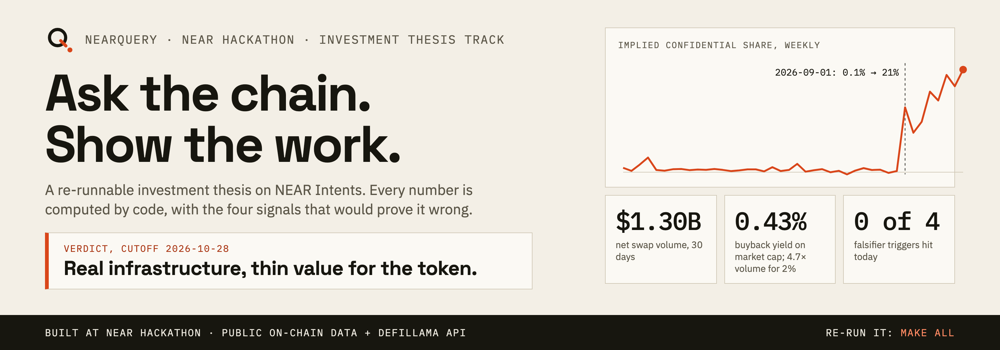
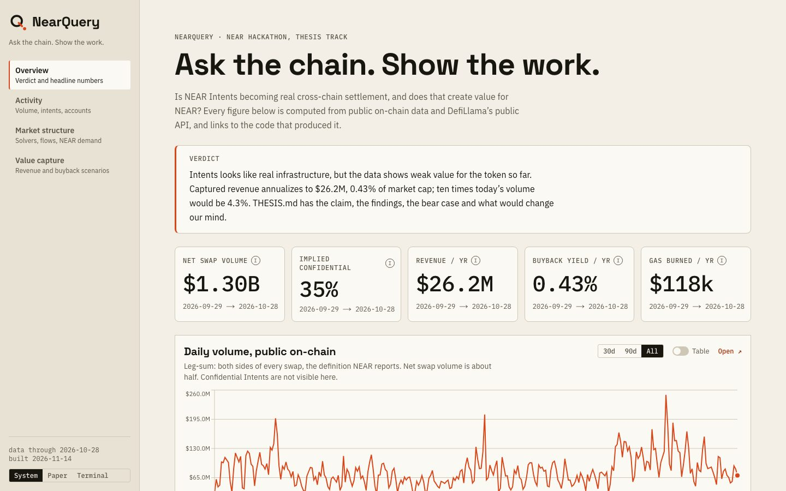
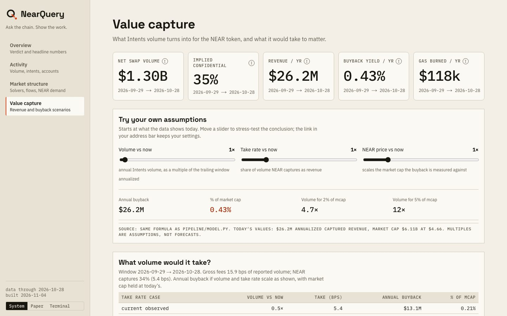
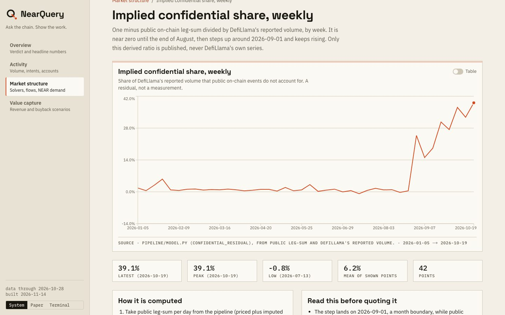
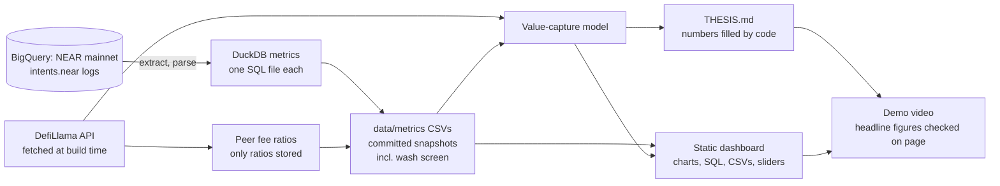
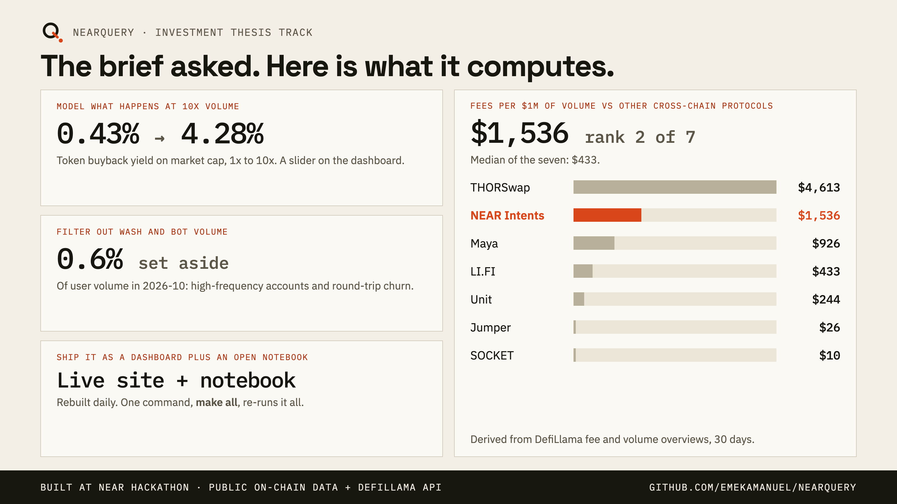

<div align="center">



# NearQuery

**A re-runnable investment thesis on NEAR Intents: every number computed by code, with the four signals that would prove it wrong.**

[Live dashboard](https://emekamanuel.github.io/nearquery/) · [Demo video (108 s)](demo/out/nearquery-demo.mp4) · [Read the thesis](THESIS.md) · [Open notebook](notebooks/nearquery.ipynb) · [Method and limits](METHODOLOGY.md)

    [](https://github.com/EmekaManuel/nearquery/actions/workflows/dashboard.yml) 

</div>

Investment Thesis track, NEAR HACKATHON. Data: NEAR mainnet `intents.near` logs and DefiLlama's public API. Read-only, not financial advice.

> **Verdict (cutoff 2026-10-28): real infrastructure, thin value for the token so far.** Captured revenue is 0.43% of NEAR's market cap, and volume would have to be 4.7x today's to reach 2%. None of the four falsifiers has triggered.

| | |
| --- | --- |
| NEAR Intents net swap volume, last 30 days | **$1.30B** |
| Captured revenue, annualized | **$26.2M** (0.43% of market cap) |
| Share of reported volume not visible on-chain | about **35%**, with a step on 2026-09-01 that may be a data change, not users |
| Fees per $1M of volume vs other cross-chain protocols | **$1,536**, rank 2 of 7 |

<table>
<tr>
<td width="50%"><br /><sub><b>The overview.</b> Verdict first, then every headline figure with its date range.</sub></td>
<td width="50%"><br /><sub><b>Stress-test it.</b> Sliders recompute the buyback with the pipeline's own formula.</sub></td>
</tr>
</table>

Figures are from the cutoff; the dashboard and THESIS.md are rebuilt from fresh data. Re-run it yourself: `make all`.

## The problem and the product

Investment cases for crypto projects are usually conviction: a story, a chart screenshot, a number nobody can re-derive. The case for NEAR leans on NEAR Intents becoming real cross-chain settlement. NearQuery replaces the story with a pipeline.

- **A call, up front.** [THESIS.md](THESIS.md) opens with a verdict and the exact condition that would flip it, then five findings, each tied to a chart and a number, and the strongest bear and bull cases.
- **Numbers that cannot drift.** The thesis is a template. Every figure is filled in by code from the committed metric snapshots, so rebuilding changes the text and the charts together, and `git diff` shows exactly what moved.
- **Charts you can audit.** The dashboard gives every chart its own page: definition, how it is computed, caveats, the DuckDB SQL behind it with a Copy button, and a CSV download.
- **A volume-quality screen and a fee benchmark.** A stated-rule wash and bot screen on user volume, and NEAR Intents' fees per $1M of volume against other cross-chain protocols, both as charts with their code.
- **A model you can break.** The value-capture model turns Intents fees into a buyback yield on market cap. Its assumptions are plain inputs, and sliders on the Value page recompute it in the browser with the pipeline's own formula.
- **Falsifiers, not hedges.** Four signals, bullish and bearish, each with a stated threshold and today's reading. Any one of them moving changes the verdict in a named direction.
- **Limits on the page.** The confidential-volume blind spot and the 2026-09-01 break are stated where the numbers appear, not in a footnote.

An [open notebook](notebooks/nearquery.ipynb) reproduces the key figures from the committed snapshots (`uv run --with jupyterlab --with matplotlib jupyter lab notebooks/nearquery.ipynb`). The pipeline, the site and the demo video are all built by code ([`demo/`](demo/)), and the recorder checks the headline figures against the page before it records.

## Key findings (cutoff 2026-10-28)

| # | Finding | Evidence |
| --- | --- | --- |
| 1 | **Scale is real, and about a third of it is invisible to us.** Public net swap volume is $1.30B over 30 days; comparing with DefiLlama's reported total implies about 35% is Confidential Intents. The implied share sits near 0.1% until 2026-09-01, then jumps to 21% on a month boundary while public volume fell 10%: as consistent with a DefiLlama coverage change as with users moving. | [Implied confidential share](https://emekamanuel.github.io/nearquery/charts/confidential-residual/) |
| 2 | **Activity is falling while ticket size rises.** Intents per day fell 52% from August to October, while leg-sum per intent rose 1.9x. The cause is only partly tested. | [Intents per day](https://emekamanuel.github.io/nearquery/charts/intents-per-day/), [USD per intent](https://emekamanuel.github.io/nearquery/charts/usd-per-intent/) |
| 3 | **Account counts are not users.** In October, 0.22% of swapping accounts were active on two or more days. | [Active accounts are not users](https://emekamanuel.github.io/nearquery/charts/accounts-not-users/) |
| 4 | **The solver market is less concentrated than in January, but re-concentrated in October.** Top-1 share fell from 66% to 32%; top-5 share was 74% in July and 90% in October. | [Solver concentration](https://emekamanuel.github.io/nearquery/charts/solver-concentration/) |
| 5 | **Value capture is thin.** NEAR keeps 34% of gross fees; annualized captured revenue is $26.2M, 0.43% of market cap. Even at 10x volume it would be 4.3%. | [Value capture](https://emekamanuel.github.io/nearquery/value/) |

**Two cross-checks.** A [wash and bot screen](https://emekamanuel.github.io/nearquery/charts/wash-screen/) (accounts with 50 or more swaps in a day, and same-day round trips) sets aside only about 0.6% of user volume in October, so these two kinds don't materially inflate the headline; it is a screen, not a detector. And NEAR Intents' gross fees of $1,536 per $1M of volume rank 2nd of 7 [cross-chain protocols](https://emekamanuel.github.io/nearquery/charts/peer-fees/) that DefiLlama lists with at least $100M of 30-day volume; NEAR keeps about a third of that. Fee definitions differ by protocol, so treat it as a rough guide.

The step in finding 1 is the interesting part: the implied confidential share sits near 0.1% until 2026-09-01, then jumps to 21% on a month boundary while public volume fell 10%. That is as consistent with a change in a third-party data series as with users moving to Confidential Intents. NearQuery states that it cannot tell which, and says what evidence would.



Figures are from the cutoff above. The dashboard and THESIS.md are rebuilt from fresh data and may differ.

## How the data is used

| Piece | What it does | Where |
| --- | --- | --- |
| `intents.near` events | NEP-297 `token_diff` logs from the public BigQuery dataset of NEAR mainnet give volume, intents, accounts, solver concentration and how often NEAR itself is traded | [`pipeline/extract_bq.py`](pipeline/extract_bq.py), [`pipeline/parse_events.py`](pipeline/parse_events.py) |
| Metrics | One DuckDB SQL file per metric, run against the parsed events | [`pipeline/sql/`](pipeline/sql/) |
| Value-capture model | Turns Intents fees into a buyback yield on market cap, with scenarios for volume, take rate and price | [`pipeline/model.py`](pipeline/model.py), [`data/reference/model_assumptions.json`](data/reference/model_assumptions.json) |
| Reported volume, fees, revenue, prices | DefiLlama's free API, fetched at build time and never committed or displayed raw (their terms) | [`pipeline/defillama.py`](pipeline/defillama.py) |
| Thesis text | `THESIS.template.md` with `{{placeholders}}` filled from the metrics, so numbers cannot drift from the data | [`pipeline/thesis.py`](pipeline/thesis.py) |
| Wash and bot screen | Two stated rules on user volume: 50+ swaps in a day, and same-day round trips in the same assets | [`pipeline/sql/90_wash_screen.sql`](pipeline/sql/90_wash_screen.sql) |
| Peer fee benchmark | DefiLlama 30-day fees over volume for bridges and bridge aggregators with at least $100M volume; only the ratio is stored | [`pipeline/peers.py`](pipeline/peers.py) |
| Falsifier thresholds | Defined once (`THRESH`), shared by the thesis, the dashboard and the video | [`pipeline/thesis.py`](pipeline/thesis.py) |

The NEAR Explorer API is deliberately not used (its terms do not allow this use).

## Try it (about 10 minutes, no accounts or keys)

Needs: `make`, [uv](https://docs.astral.sh/uv/), Python 3.12, Node 20+, internet access (DefiLlama API and Google Fonts at build time). Do each step, then look for the result.

| # | Do | See |
| --- | --- | --- |
| 1 | `make setup` | Pinned Python dependencies install into `.venv` (uv, frozen lockfile). |
| 2 | `make rebuild` | Re-fetches DefiLlama volume, fees and revenue, reruns the value-capture model (a table of observed inputs prints), emits `dashboard/data/dashboard.json`, then builds the site: `Generating static pages (19/19)`. |
| 3 | `make thesis`, then `git diff THESIS.md` | The thesis is re-rendered from the metrics. The diff is empty: every number is reproducible. |
| 4 | `npx serve dashboard/out`, open the printed URL | The overview: verdict, five headline figures (each with its date range), and the daily volume chart. |
| 5 | On any chart click **Open ↗** | The chart's page: definition, how it is computed, caveats, the SQL (with a Copy button) and a CSV link. |
| 6 | Edit `volume_multiples` in `data/reference/model_assumptions.json`, then `make model thesis dashboard` | The scenario table on the **Value capture** page and in THESIS.md changes. Assumptions are inputs, not hidden constants. |
| 7 | On the **Value capture** page, move the sliders under "Try your own assumptions" | Annual buyback and % of market cap recompute in the browser with the same formula as `pipeline/model.py`; at the defaults they equal the pipeline's own 1x row. The URL hash keeps your settings. |

Or run steps 1 to 3 as one command: `make all`.

Optional, full rebuild from raw chain data (needs your own Google Cloud project on the free BigQuery sandbox, no billing):

```bash
cp .env.example .env            # set GOOGLE_CLOUD_PROJECT
gcloud auth application-default login
make extract-logs reference metrics model thesis dashboard
```

Each BigQuery chunk is dry-run first and refuses to exceed `--max-gb`; cached days are never re-queried. The raw cache (`data/raw/`) is not committed; the derived metric CSVs in `data/metrics/` and the SQL in `pipeline/sql/` are.

## Tests

```bash
make test        # 33 offline tests, about a second, no network and no BigQuery
```

They run against the committed snapshots and guard the claims this README makes:

- **Reproducibility:** `THESIS.md` is re-rendered in memory from the template and the snapshots and must match the committed file exactly; every `{{placeholder}}` must have a computed value.
- **One source for the thresholds:** the four falsifier thresholds flow from `THRESH` into the text, and no copy of them exists in the dashboard or video code.
- **Reconciliation:** before Confidential Intents launched, public leg-sum must stay within 2% of reported volume with a daily correlation above 0.99, and imputation must add volume.
- **The confidential break:** the implied share stays near zero before the break date and above 10% after it.
- **The model:** the 1x row equals the observed yield, buyback scales linearly with volume, and the dashboard sliders use the same formula as the pipeline.
- **Wash screen and peers:** shares add up to one, the peer selection rule is applied as written, and only the derived ratio is published. Raw third-party series must stay gitignored.
- **Extraction, with BigQuery mocked:** the log parser (swaps, mints, malformed JSON, failed receipts, empty days), month and day chunking, the dry-run-first and no-cache settings, the `--max-gb` budget guard, and that a cached day is never queried twice.
- **The real SQL on a synthetic cache:** `00_setup.sql`, the daily-volume query and the wash screen run on a tiny hand-built swap cache with known answers (a bot, a round-trip trader, a solver) and must reproduce them exactly.
- **Registry:** every chart references SQL, Python files and CSVs that exist, and chart ids are unique.

The daily workflow runs the suite before it refetches anything.

## How it works



**Design rules**

- **Computed, never typed.** Thesis text, dashboard figures and video captions all read from the same pipeline output. If the data moves, they move together.
- **Falsifiable.** The four triggers and their thresholds are defined once and shown with today's reading. The video's falsifier card refuses to render if any trigger has fired without a per-row status.
- **Honest about limits.** Each derived series carries its caveats on the page. The implied confidential share is labeled a residual, not a measurement.
- **No secrets, no raw third-party data.** `.env` is ignored; only `.env.example` is committed. DefiLlama series are re-fetched at build time and never published.

```
pipeline/     Extraction, parsing, metrics runner, model, thesis renderer
pipeline/sql/ The DuckDB SQL behind each chart
data/         Committed metric snapshots and reference assumptions
dashboard/    Next.js + TypeScript + Radix + Recharts static site
notebooks/    Open notebook that reproduces the key figures from the snapshots
demo/         The demo video, built with Remotion, Playwright and VHS
brand/        Brand tokens, logos and social card
.github/      Daily rebuild of the site from snapshots plus a fresh DefiLlama pull
```

## Fit to the track

The Investment Thesis track is judged on the evidence, not the conviction. Each line below names the code that does it, how it is checked, and what to try.



| The track asks for | In NearQuery | Code | Checked by | Try it |
| --- | --- | --- | --- | --- |
| **A clear, falsifiable call** | A verdict first, with the exact condition that flips it, and four triggers with thresholds defined once (`THRESH`) and shown with today's readings | [`pipeline/thesis.py`](pipeline/thesis.py), [`THESIS.template.md`](THESIS.template.md) | `make test`: every placeholder has a computed value and `THESIS.md` matches a fresh render; the video's falsifier card refuses to render if a trigger has fired | Open [THESIS.md](THESIS.md), "What would change our mind" |
| **Evidence you can check** | Every figure traces to a chart page, the code behind it (SQL, or the Python file where there is no SQL) and a CSV | [`pipeline/sql/`](pipeline/sql/), [`dashboard/lib/charts.ts`](dashboard/lib/charts.ts) | Reconciliation recomputed on every build (`data/metrics/reconciliation.csv`): public leg-sum within about 1% of DefiLlama's reported volume before Confidential Intents launched, daily correlation 0.997 | On any chart, **Open**, then **Copy** the SQL |
| **Honesty about uncertainty** | The strongest bear case, the residual caveat, the 2026-09-01 break and the cross-check gaps are stated beside the numbers | [`METHODOLOGY.md`](METHODOLOGY.md), [`dashboard/lib/charts.ts`](dashboard/lib/charts.ts) | Each derived chart carries a "Read this before quoting it" card | [Implied confidential share](https://emekamanuel.github.io/nearquery/charts/confidential-residual/) |
| **Re-runnable** | One command, no accounts or keys | [`Makefile`](Makefile) | `make test`, and `make thesis` then `git diff THESIS.md` is empty | `make all` |
| **Stress-testable** | Sliders for volume, take rate and NEAR price, with the 2% and 5% market-cap trigger multiples | [`dashboard/components/ScenarioExplorer.tsx`](dashboard/components/ScenarioExplorer.tsx), [`pipeline/model.py`](pipeline/model.py) | At the defaults the slider result equals the pipeline's own 1x row | **Value capture** page |
| **Classify swaps; filter wash and bot volume** | Monthly volume by source chain and pair, and a stated-rule wash and bot screen: it sets aside about 0.6% of user volume in the latest full month | [`pipeline/sql/80_chain_pairs.sql`](pipeline/sql/80_chain_pairs.sql), [`pipeline/sql/90_wash_screen.sql`](pipeline/sql/90_wash_screen.sql) | The rules and thresholds are stated on the chart page; it is a screen, not a detector | [Wash and bot screen](https://emekamanuel.github.io/nearquery/charts/wash-screen/) |
| **Fees against other cross-chain protocols** | NEAR Intents' fees per $1M of volume against every bridge and bridge aggregator DefiLlama lists with at least $100M of 30-day volume | [`pipeline/peers.py`](pipeline/peers.py) | Fixed selection rule; only the ratio is published | [Fees per $1M](https://emekamanuel.github.io/nearquery/charts/peer-fees/) |
| **Built on NEAR** | The whole analysis is of NEAR's own chain: `intents.near` settlement and the NEAR token's value capture | [`pipeline/extract_bq.py`](pipeline/extract_bq.py), [`pipeline/parse_events.py`](pipeline/parse_events.py) | Public BigQuery dataset of NEAR mainnet, read-only | Any chart's source line |

## What is real, and what is not

**Computed from public data and re-runnable:**

- Volume, intents per day, accounts, solver concentration and how often NEAR is a leg of a swap, from `intents.near` event logs.
- The value-capture model and its scenarios, and the four falsifier readings.
- The thesis text and every figure in it, rebuilt from the committed snapshots.

**Not what it might sound like:**

- **The implied confidential share is a residual, not a measurement.** It is one minus our public total over DefiLlama's reported volume, so it absorbs any coverage difference. The thesis says it cannot tell migration from a data change.
- **Captured revenue is DefiLlama's reported figure,** not a sum of the on-chain events we can see. We cannot verify how fully it includes Confidential Intents.
- **DefiLlama's volume derives from Dune,** so cross-checking against Dune checks our transcription, not an independent source. Recent windows differ by about 0 to 17% depending on the window definition, and that gap is unresolved.
- **The wash and bot screen is a screen.** Two stated rules with stated thresholds; it cannot see cycling across accounts or days.
- **The fee benchmark is rough.** Fee definitions differ by protocol in DefiLlama, and the peer set is limited to protocols with both fees and volume listed.
- **Accounts are not users.** Nearly every account is used on a single day, so adoption cannot be shown from account counts.
- **The model's multiples are assumptions, not forecasts.** The thesis does not predict that volume will arrive.
- **The tests do not call live BigQuery.** The extraction is tested with BigQuery mocked and the SQL on a synthetic cache; a run against the real public dataset needs your own Google Cloud project and is checked through the reconciliation against reported volume.
- **Not financial advice.** Read-only, no wallets, keys, contracts or transactions.

## Coverage

The on-chain cache covers every day from 2026-01-01 to the cutoff shown on each chart (no missing days); earlier history is not pulled. Confidential Intents (generally available since 2026-07-07) are not visible in on-chain events, so every on-chain trend here is the public side only. Cross-checks and reconciliation are in [METHODOLOGY.md](METHODOLOGY.md).

## What's next

- **Direct confidential volume:** replace the residual with a first-hand figure from the NEAR side if one becomes available, and re-run.
- **Longer history:** extend the on-chain cache before 2026-01-01.
- **Live, not daily:** the dashboard rebuilds daily; a streaming view would need a hosted backend.
- **More triggers:** add falsifiers as new evidence appears, keeping each one defined once.

## Built at NEAR HACKATHON

- **Window:** all code, SQL and prose in this repository was written on or after 2026-10-19. The first commit (2026-10-30) is only the project scaffold; it is the `pre-hackathon` tag, so there is no earlier code and no pre-window baseline to subtract. The `hackathon-submission` tag marks the entry; the diff between the two is `https://github.com/EmekaManuel/nearquery/compare/pre-hackathon...hackathon-submission`.
- **AI assistance:** built with Claude Code (Anthropic) as a coding assistant and reviewed by the author, as the hackathon rules allow. Correctness does not rest on who wrote the code: every figure is computed from public data and re-checked by `make all`. The demo video's voiceover was generated with ElevenLabs from the author's own cloned voice, reading the script in `demo/scripts/voiceover.py`; the video itself is rendered from code in `demo/` (Remotion, Playwright, VHS, ffmpeg).
- **Libraries and tools:** see [LIBRARIES.md](LIBRARIES.md) (generated from the lockfiles).
- **Other project:** [Nims](https://github.com/EmekaManuel/nims) is the author's other NEAR Hackathon entry. The two projects are independent. This repository was built from scratch and does not import or vendor Nims code.
- **License:** MIT, see [LICENSE](LICENSE).
