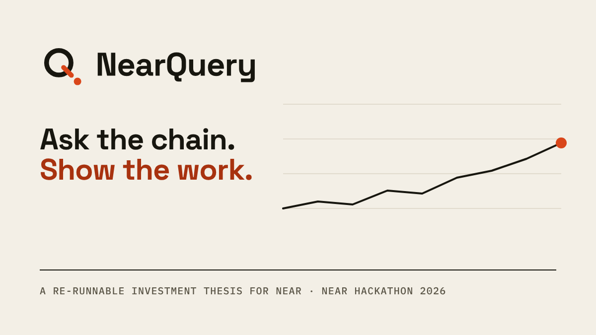
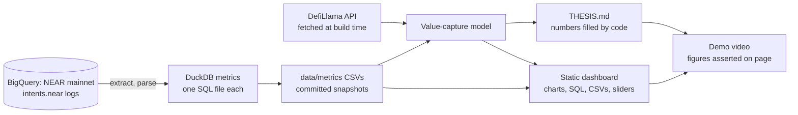

<div align="center">



# NearQuery

**A re-runnable investment thesis on NEAR Intents. Every number is computed from public on-chain data, and it says what would prove it wrong.**

[Live dashboard](https://emekamanuel.github.io/nearquery/) · [Demo video (94 s)](demo/out/nearquery-demo.mp4) · [Read the thesis](THESIS.md) · [Method and limits](METHODOLOGY.md)

   

</div>

Track: **Investment Thesis** (NEAR HACKATHON), judged on the evidence, not the conviction. Public on-chain data only. Read-only: no wallets, keys, contracts or transactions. Not financial advice.

## The question and the answer

Is NEAR Intents becoming real cross-chain settlement, and does that create value for the NEAR token?

At the 2026-10-28 cutoff, the data says: **real infrastructure, thin value for the token so far.** The figures below are from that cutoff; the dashboard and THESIS.md are rebuilt from fresh data.

| Finding | Figure |
| --- | --- |
| NEAR Intents net swap volume, last 30 days | **$1.30B** |
| Captured revenue, annualized | **$26.2M**, a **0.43%** buyback yield on NEAR's market cap |
| Volume needed for that yield to reach 2% of market cap | **4.7x** today's |
| Share of reported volume not visible in public events | about **35%** |
| Falsifier triggers hit today | **none of the four** |

The step in that 35% is the interesting part. The implied confidential share sits near 0.1% until 2026-09-01, then jumps to 21% on a month boundary while public volume fell 10%. That is as consistent with a change in a third-party data series as with users moving to Confidential Intents. NearQuery states that it cannot tell which, and says what evidence would.

<table>
<tr>
<td width="50%"><br /><sub><b>The overview.</b> Verdict first, then every headline figure with its date range.</sub></td>
<td width="50%"><br /><sub><b>Stress-test it.</b> Sliders recompute the buyback with the pipeline's own formula.</sub></td>
</tr>
<tr>
<td colspan="2"><br /><sub><b>The surprise.</b> The implied confidential share is flat until 2026-09-01, then steps up. The page carries a "read this before quoting it" card.</sub></td>
</tr>
</table>

## What is in it

- **The thesis:** [THESIS.md](THESIS.md) has a verdict up front, five findings each tied to a chart and a number, the strongest bear and bull cases, four falsifiable "what would change our mind" triggers with today's readings, and a value-capture model with editable assumptions. It is rendered by code from the committed snapshots, so no number is typed by hand.
- **The dashboard:** a static Next.js site. Every chart has its own page with its definition, how it is computed, caveats, the DuckDB SQL behind it with a Copy button, and a CSV download.
- **The pipeline:** BigQuery extraction of `intents.near` event logs, DuckDB metrics, a value-capture model and the thesis renderer. One command, `make all`, rebuilds everything from the committed data.
- **The demo video:** built by code too ([`demo/`](demo/)), with every on-screen figure asserted against the page before it is recorded.

## How the data is used

| Piece | What it does | Where |
| --- | --- | --- |
| `intents.near` events | NEP-297 `token_diff` logs from the public BigQuery dataset of NEAR mainnet give volume, intents, accounts, solver concentration and how often NEAR itself is traded | [`pipeline/extract_bq.py`](pipeline/extract_bq.py), [`pipeline/parse_events.py`](pipeline/parse_events.py) |
| Metrics | One DuckDB SQL file per metric, run against the parsed events | [`pipeline/sql/`](pipeline/sql/) |
| Value-capture model | Turns Intents fees into a buyback yield on market cap, with scenarios for volume, take rate and price | [`pipeline/model.py`](pipeline/model.py), [`data/reference/model_assumptions.json`](data/reference/model_assumptions.json) |
| Reported volume, fees, revenue, prices | DefiLlama's free API, fetched at build time and never committed or displayed raw (their terms) | [`pipeline/defillama.py`](pipeline/defillama.py) |
| Thesis text | `THESIS.template.md` with `{{placeholders}}` filled from the metrics, so numbers cannot drift from the data | [`pipeline/thesis.py`](pipeline/thesis.py) |
| Falsifier thresholds | Defined once (`THRESH`), shared by the thesis, the dashboard and the video | [`pipeline/thesis.py`](pipeline/thesis.py) |

The NEAR Explorer API is deliberately not used (its terms do not allow this use).

## Try it (about 10 minutes, no accounts or keys)

Needs: `make`, [uv](https://docs.astral.sh/uv/), Python 3.12, Node 20+, internet access (DefiLlama API and Google Fonts at build time). Do each step, then look for the result.

| # | Do | See |
| --- | --- | --- |
| 1 | `make setup` | Pinned Python dependencies install into `.venv` (uv, frozen lockfile). |
| 2 | `make rebuild` | Re-fetches DefiLlama volume, fees and revenue, reruns the value-capture model (a table of observed inputs prints), emits `dashboard/data/dashboard.json`, then builds the site: `Generating static pages (17/17)`. |
| 3 | `make thesis`, then `git diff THESIS.md` | The thesis is re-rendered from the metrics. The diff is empty: every number is reproducible. |
| 4 | `npx serve dashboard/out`, open the printed URL | The overview: verdict, five headline figures (each with its date range), and the daily volume chart. |
| 5 | On any chart click **Open ↗** | The chart's page: definition, how it is computed, caveats, the SQL (with a Copy button) and a CSV link. |
| 6 | Edit `volume_multiples` in `data/reference/model_assumptions.json`, then `make model thesis dashboard` | The scenario table on the **Value capture** page and in THESIS.md changes. Assumptions are inputs, not hidden constants. |
| 7 | On the **Value capture** page, move the sliders under "Try your own assumptions" | Annual buyback and % of market cap recompute in the browser with the same formula as `pipeline/model.py`; at the defaults they equal the pipeline's own 1x row. The URL hash keeps your settings. |

Or run steps 1 to 3 as one command: `make all`.

Optional, full rebuild from raw chain data (needs your own Google Cloud project on the free BigQuery sandbox, no billing):

```bash
cp .env.example .env            # set GOOGLE_CLOUD_PROJECT
gcloud auth application-default login
make extract-logs reference metrics model thesis dashboard
```

Each BigQuery chunk is dry-run first and refuses to exceed `--max-gb`; cached days are never re-queried. The raw cache (`data/raw/`) is not committed; the derived metric CSVs in `data/metrics/` and the SQL in `pipeline/sql/` are.

## How it works



**Design rules**

- **Computed, never typed.** Thesis text, dashboard figures and video captions all read from the same pipeline output. If the data moves, they move together.
- **Falsifiable.** The four triggers and their thresholds are defined once and shown with today's reading. The video's falsifier card refuses to render if any trigger has fired without a per-row status.
- **Honest about limits.** Each derived series carries its caveats on the page. The implied confidential share is labeled a residual, not a measurement.
- **No secrets, no raw third-party data.** `.env` is ignored; only `.env.example` is committed. DefiLlama series are re-fetched at build time and never published.

```
pipeline/     Extraction, parsing, metrics runner, model, thesis renderer
pipeline/sql/ The DuckDB SQL behind each chart
data/         Committed metric snapshots and reference assumptions
dashboard/    Next.js + TypeScript + Radix + Recharts static site
demo/         The demo video, built with Remotion, Playwright and VHS
brand/        Brand tokens, logos and social card
.github/      Daily rebuild of the site from snapshots plus a fresh DefiLlama pull
```

## Fit to the track

| The track asks for | NearQuery |
| --- | --- |
| A clear, falsifiable call | A verdict up front, and four triggers with thresholds that would change it |
| Evidence you can check | Every figure traces to a chart page, its SQL and a CSV; `make all` reproduces it |
| Honesty about uncertainty | The strongest bear case, the confidential-volume blind spot and the 2026-09-01 break are stated, not hidden |
| Re-runnable | One command, no accounts or keys, and an empty diff on `THESIS.md` |
| Built on NEAR | The whole analysis is of NEAR's own chain: `intents.near` settlement and the NEAR token's value capture |

## Known limits

- Confidential Intents (generally available since 2026-07-07) are not visible in on-chain events. The dashboard shows public activity only, and the implied confidential share is an inference.
- The on-chain cache covers every day from 2026-01-01 to the cutoff shown on each chart (no missing days); earlier history is not pulled.
- Account counts are not user counts: nearly every account is used on a single day. The thesis treats this as a measurement limit.
- Captured revenue is DefiLlama's reported figure, not a sum of the on-chain events we can see.

Details, cross-checks and reconciliation against reported volume are in [METHODOLOGY.md](METHODOLOGY.md).

## What's next

- **Direct confidential volume:** replace the residual with a first-hand figure from the NEAR side if one becomes available, and re-run.
- **Longer history:** extend the on-chain cache before 2026-01-01.
- **More triggers:** add falsifiers as new evidence appears, keeping each one defined once.

## Built at NEAR HACKATHON

- **Window:** all code, SQL and prose in this repository was written on or after 2026-10-19. There is no pre-window baseline. Releases are marked with the tags `pre-hackathon` (the repository's first commit) and `hackathon-submission`; the diff between them is `https://github.com/EmekaManuel/nearquery/compare/pre-hackathon...hackathon-submission`.
- **AI assistance:** built with Claude Code (Anthropic) as a coding assistant and reviewed by the author, as the hackathon rules allow. Correctness does not rest on who wrote the code: every figure is computed from public data and re-checked by `make all`.
- **Libraries and tools:** see [LIBRARIES.md](LIBRARIES.md) (generated from the lockfiles).
- **Other project:** [Wucant](https://github.com/EmekaManuel/wucant) is the author's other NEAR Hackathon entry. The two projects are independent. This repository was built from scratch and does not import or vendor Wucant code.
- **License:** MIT, see [LICENSE](LICENSE).
